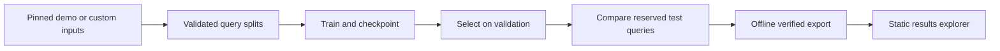
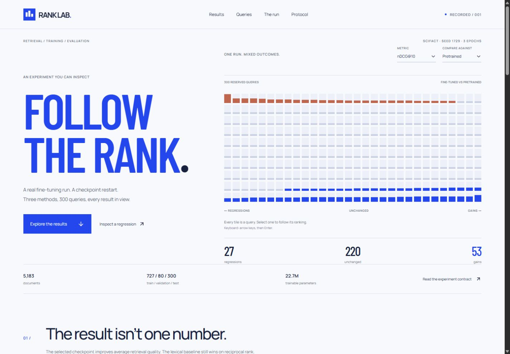
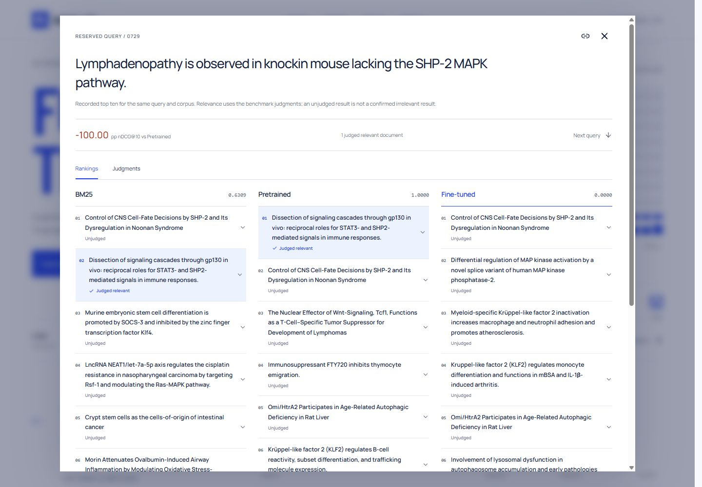

#  Rank Lab

**Fine-tune a retrieval model on your data, compare it with baselines, and inspect each result.**

I built Rank Lab to see how fine-tuning changes individual search results. It includes the
training workflow, checkpoint recovery, baseline comparisons and a browser explorer for the
ranked documents. The first study compares BM25, a frozen MiniLM encoder and a fine-tuned
checkpoint on SciFact.
Version 0.2 adds configurable local experiments with your own documents, queries and relevance
judgments, plus portable results that open in the same explorer.

On SciFact, the average improved, while 27 of the 300 test queries got worse. You can inspect
those regressions alongside the gains, with the rankings and relevance judgments for each query.

## Demo

https://github.com/user-attachments/assets/fb29136d-a992-4f04-a806-d3d1321ac72b

[Run your own experiment](docs/CUSTOM-DATA.md) ·
[Explore a real gain and regression](docs/CASE-STUDY.md) ·
[Open the results explorer](https://shayanxcyber.github.io/rank-lab/)

Explore the [experiment](docs/STUDY.md), [engineering case study](docs/CASE-STUDY.md),
or run the results explorer below. The interface displays a recorded study locally; it doesn't
launch training from the browser.

The first local experiment completed on Windows with an RTX 5080 (16 GB GDDR7 VRAM): 78 optimizer steps,
three epochs, and a real checkpoint restart after step two. All 22,713,216 encoder parameters
were trainable. Validation selected epoch three before the reserved 300-query test comparison.

| Method | nDCG@10 | Recall@10 | MRR@10 |
| --- | ---: | ---: | ---: |
| BM25 | 0.6646 | 0.7816 | **0.6340** |
| Pretrained MiniLM | 0.6451 | 0.7833 | 0.6047 |
| Fine-tuned MiniLM | **0.6751** | **0.8348** | 0.6286 |

Fine-tuning improved nDCG@10 by 3.00 percentage points over the frozen encoder.
BM25 still had the best reciprocal rank. These are observed results from one seed on one
benchmark. The [study](docs/STUDY.md) explains the protocol and tradeoffs.

## What this is useful for

Use the lab when a retrieval experiment needs more than a final metric table. A developer
comparing a lexical baseline with an embedding model can inspect which queries changed,
which documents caused the change, and which checkpoint produced those rankings. Someone
reviewing the experiment can follow its inputs, restart and selection decision without
running a GPU job.

The recorded study makes that workflow concrete:

1. Compare all three methods and switch the metric or baseline. The query field and outcome
   counts update together, so an average gain never hides the regressions.
2. Open query **742**: its relevant document moves from pretrained rank **9** to fine-tuned
   rank **1**. Open query **729** to see the opposite: the relevant document falls out of
   the fine-tuned top ten. Inspect titles, abstracts and the complete benchmark judgments.
3. Follow the training trace and checkpoint selection, then download the per-query results
   to investigate further. The browser displays the completed run; the Python CLI handles
   preparing and training a fresh study.

This is a focused retrieval experiment and inspection tool. It is not a hosted model service
or a general experiment tracker. The committed explorer works without credentials or weights.

## What I built, and why

I kept the training results and browser data in the same workflow. The exporter calculates
the displayed scores from saved rankings and judgments, and checks which inputs and checkpoint
produced them.

| Engineering choice | Problem it addresses | Implemented behavior |
| --- | --- | --- |
| Pinned inputs and verified bytes | A dataset or model can change underneath a repeated run | Revision-pinned downloads, Git/LFS identity checks and atomic artifact replacement |
| Query grouping before training | Exact train/test text overlap can contaminate the comparison | Explicit training-only exclusions and a seeded grouped split; raw files and all test queries retained |
| Masked contrastive negatives | Another relevant document in the batch should not be taught as a negative | Known-positive masking inside the loss computation |
| Complete restart state | Loading weights alone does not resume the same optimizer trajectory | Model, optimizer, scheduler, batch cursor and RNG state; compatibility checks on resume |
| Validation before test | Choosing a checkpoint from test results weakens the experiment | Per-epoch validation checkpoints, deterministic selection and model fingerprints checked before comparison |
| Custom experiment inputs | Reusing the study required source edits | JSONL documents/queries, graded TSV labels and config-relative TOML settings |
| Portable browser import | A new corpus should use the same inspection workflow | Local bundle validation, data-dependent views and current-study downloads |
| Offline result export | Presentation numbers can drift from the saved rankings | Scores recomputed from judgments and top-ten results; identity and coverage checked |
| Detail loaded on demand | Full abstracts made the opening payload unnecessarily large | Initial study reduced from about 5.38 MB to 0.89 MB; separate abstracts verified by SHA-256 |
| Per-query inspection | An average does not explain which queries changed | All-query field, linked rankings/judgments, regression filters, responsive rows and keyboard navigation |

<details>
<summary>How the pieces connect</summary>



</details>

The [engineering case study](docs/CASE-STUDY.md) explains the consequences of these decisions,
and the [study record](docs/STUDY.md) provides the exact configuration, hashes and limitations.

The lab verifies pinned file identities, rejects exact normalized query overlap between splits,
masks other known positive documents during contrastive learning, and stores model, optimizer,
scheduler and RNG state at each checkpoint. The backend and explorer data tests
pass, including controlled CPU restart equivalence and checks that exported scores match rankings.
The GPU run resumed successfully; GPU equivalence to a second uninterrupted run is untested.

## Hardware and runtime

The local training run and CPU regression tests ran on this workstation:

| Component | Specification |
| --- | --- |
| GPU | NVIDIA GeForce RTX 5080, **16 GB GDDR7 VRAM** |
| CPU | AMD Ryzen 7 9800X3D, 8 cores / 16 threads |
| System memory | 32 GB RAM (2 × 16 GB) |
| Operating system | Windows 11 Pro, version 10.0.26200 |
| Training runtime | Python 3.11.15, PyTorch 2.7.1+cu128, CUDA 12.8 |
| Web toolchain | Node.js 22.23.2 |

Peak allocated CUDA memory in the resumed training invocation was **2.74 GiB**
(2,943,213,568 bytes), distinct from the card's total VRAM capacity. Its measured training
and validation duration was 54.85 seconds, excluding preparation, the frozen baseline and
the first two-step invocation. These figures describe this run rather than minimum hardware
requirements. GPU memory capacity follows the [NVIDIA specification](https://www.nvidia.com/en-us/geforce/graphics-cards/50-series/rtx-5080/).

## Explore the recorded run

```powershell
cd web
npm ci
npm run dev
```

Open `http://127.0.0.1:3032`. Node 22.12 or newer is required for the locked toolchain.
The committed fixture includes all 300 test queries, three top-ten rankings per query and the
3,111 corpus documents that occur in those rankings or judgments. It excludes model weights,
training state, caches and personal records. No external API or account is required to explore it.

- Switch between nDCG, Recall and reciprocal rank, against either baseline.
- Search queries, filter gains and regressions, and sort the comparison.
- Open a query to compare the three rankings and complete relevance judgments.
- Expand an abstract; its separate file loads on demand and verifies against the study's hash.
- Follow the actual 78-step loss/gradient trace and validation checkpoint selection.
- Download the complete per-query CSV or inspect the recorded JSON.

For nDCG against the frozen encoder, **53 queries improve, 27 regress and 220 are unchanged**.
Those cases explain more than the average alone. The explorer preserves the distinctions between
judged relevant, judged non-relevant and unjudged documents.

## Run your own experiment

Start with the [complete custom-data guide](docs/CUSTOM-DATA.md) and the original fictional
[helpdesk example](examples/helpdesk). Prepare JSONL documents/queries and TSV relevance
judgments, choose a TOML configuration, then run the same CLI through training and comparison.

```powershell
.venv/Scripts/python.exe -m rank_lab.cli prepare --config examples/helpdesk/experiment.toml
.venv/Scripts/python.exe -m rank_lab.cli train --workspace runs/helpdesk --stop-after-steps 2
.venv/Scripts/python.exe -m rank_lab.cli train --workspace runs/helpdesk --resume
.venv/Scripts/python.exe -m rank_lab.cli compare --workspace runs/helpdesk
.venv/Scripts/python.exe -m rank_lab.cli export --workspace runs/helpdesk --resumed-after-step 2
```

The guide includes installation, CPU/CUDA choices, input schemas, configuration overrides and
troubleshooting. Later commands recover the prepared settings from the workspace. Choose
**Open experiment** in the live explorer and select `runs/helpdesk/export/rank-lab-study.json`.
The bundle stays in your browser. Counts, labels, charts, document inspection and CSV downloads
follow the loaded result; **SciFact demo** returns to the original study.

The small example exercises real gradients, checkpoint recovery and validation selection. Its
simple fictional labels are a workflow demonstration, not a general retrieval benchmark.
Custom data needs queries and relevance judgments; document upload alone does not supply them.

## Repeat the original SciFact study

```powershell
uv venv --python 3.11 .venv
uv pip install --python .venv/Scripts/python.exe torch==2.7.1 --index-url https://download.pytorch.org/whl/cu128
uv pip install --python .venv/Scripts/python.exe -e ".[dev]"
uv run --no-project --python .venv/Scripts/python.exe python -m rank_lab.cli prepare
uv run --no-project --python .venv/Scripts/python.exe python -m rank_lab.cli train --stop-after-steps 2
uv run --no-project --python .venv/Scripts/python.exe python -m rank_lab.cli train --resume
uv run --no-project --python .venv/Scripts/python.exe python -m rank_lab.cli compare
uv run --no-project --python .venv/Scripts/python.exe python -m rank_lab.cli export --resumed-after-step 2
```

The commands use `runs/scifact` by default. For a CPU setup, install Torch from its CPU wheel
index and pass `--device cpu` to training and comparison. The original study used the selected Windows GPU path; the v0.2 helpdesk workflow was also exercised end to end on CPU and CUDA. Input downloads are public; model loading
and gradients use verified local files. The final comparison refuses to overwrite an existing
result. Use a new workspace for another study.

In v0.2, export defaults to `WORKSPACE/export`; it no longer replaces the committed web demo.
Open its `rank-lab-study.json` through **Open experiment**. An explicit destination containing a
different comparison is rejected.

Export is offline: it reads the completed comparison, checks data identity and recomputes the
scores from saved rankings and judgments. It never encodes documents, trains or reevaluates the
model. The restart annotation is supplied explicitly; only annotate a restart that actually ran.

## Check the implementation

```powershell
.venv/Scripts/python.exe -m pytest -q
.venv/Scripts/ruff.exe check src tests
.venv/Scripts/ruff.exe format --check src tests
cd web
npm test
npm run build
```

The check workflow runs backend regressions, explorer data tests and the explorer build.
It uses CPU fixtures and the committed study; training a model is a separate command.

The interface uses Base UI controls, TanStack Table, Observable Plot, Motion, Lucide and self-hosted
typefaces. [Resource notes](docs/RESOURCES.md) explain the applied pieces and source attribution.

The study uses public benchmark data and pretrained weights. Its engineering is original;
the model, tokenizer, corpus and relevance judgments retain their upstream attribution.
Personal applications and private data are excluded.

Sources: [SciFact corpus](https://huggingface.co/datasets/BeIR/scifact),
[judgments](https://huggingface.co/datasets/BeIR/scifact-qrels),
[MiniLM](https://huggingface.co/sentence-transformers/all-MiniLM-L6-v2).

<details>
<summary>Interface views</summary>

| All-query explorer | Ranking inspector |
| --- | --- |
| <a href="docs/media/explorer.jpg"></a> | <a href="docs/media/query-inspector.jpg"></a> |
| Start with the full distribution, then filter a particular outcome. | Follow a score into the documents and benchmark judgments behind it. |

[View the mobile judgment layout](docs/media/mobile-judgments.jpg).

</details>
